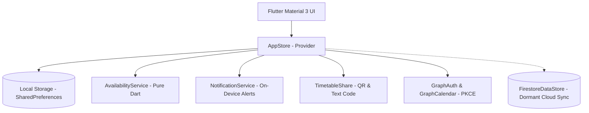

# When R U Free — Documentation

Welcome to the comprehensive documentation for **When R U Free**, a local-first, privacy-respecting cross-platform Flutter application designed to help sixth form, college, and university students compare scattered timetables and effortlessly discover shared free periods between lessons.

---

## Documentation Index

| Guide | Description |
| :--- | :--- |
| **[Architecture & Design](architecture.md)** | Explains the local-first philosophy, offline state management, data persistence, and security model. |
| **[Features & User Guide](features.md)** | In-depth walkthrough of all 12 core features, user interface components, and workflows. |
| **[Availability Algorithm](availability-algorithm.md)** | Technical breakdown of interval carving, mutual intersection, grouped adaptive blocks, and ranking algorithms. |
| **[Microsoft 365 / Graph Setup](microsoft-graph-setup.md)** | Setup guide for Azure App Registration, public-client OAuth 2.0 PKCE, and the calendar import flow. |
| **[Cloud Sync & Firebase Guide](cloud-sync-setup.md)** | Architecture of the dormant cloud sync layer, Firestore database rules, and activation steps. |
| **[Development & Testing Guide](development.md)** | Prerequisites, local development environment, running tests, and code standards. |
| **[Changelog](changelog/README.md)** | Version history, release notes, and migration details. |

---

## Quick Architecture Overview

- **Local-First:** All timetable comparisons, busy calculations, and alert schedulers execute directly on the user's device without requiring a server or cloud account.
- **Privacy by Default:** Friends are stored locally as names and timetables; peer-to-peer sharing uses client-generated QR codes or text snippets without uploading data.
- **Extensible:** The application contains dormant cloud connectors (Firebase Auth & Firestore) ready for seamless multi-device sync once configured.
