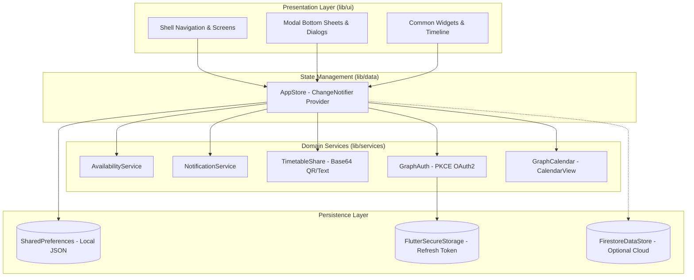

# Architecture & Technical Design

When R U Free is built on a **local-first, privacy-respecting architecture**. The core belief behind this design is that personal student timetables should never require a mandatory remote account, database connection, or external server to be fully useful.

---

## 1. Core Principles

1. **Local-First & Offline-First:**
   All core operations—timetable creation, interval carving, mutual intersection, ranking, and notification scheduling—run entirely on the client device.
2. **Zero-Knowledge Privacy:**
   In offline mode, friends are simply locally-assigned names with weekly lesson arrays. Timetables are transferred peer-to-peer via optical QR scanning or direct text copy-paste.
3. **No-Data-Stored PKCE Authentication:**
   Microsoft 365 calendar import uses OAuth 2.0 Authorization Code Flow with PKCE (Proof Key for Code Exchange). Only the OAuth refresh token is saved (in platform-native secure storage); no personal student calendar events are ever written to remote servers.
4. **Decoupled Cloud Activation:**
   The Firebase sync layer exists in code, but is structurally dormant until API keys are provided and a compile-time flag (`kCloudBackendEnabled`) is flipped.

---

## 2. Component Overview

---

## 3. State Management & Data Flow

State is managed centrally via `AppStore` (located in `lib/data/app_store.dart`), exposing a `ChangeNotifier` consumed across UI widgets with the `provider` package.

### Mutation Flow
Whenever an action occurs (e.g. adding a lesson, toggling a friend, adding a busy override, or modifying day bounds):
1. The state mutation is applied to in-memory collections (`lessons`, `friends`, `busyBlocks`).
2. Synchronous validation occurs (preventing invalid time ranges or corrupted inputs).
3. `_save()` serializes updated entities to local `SharedPreferences`.
4. If gaps changed, `NotificationService.instance.reschedule()` is invoked to update upcoming break alerts.
5. If cloud sync is active, `FirestoreDataStore` pushes the profile and lessons asynchronously without blocking the UI thread.
6. `notifyListeners()` triggers granular widget rebuilds.

---

## 4. Models & Schemas

The domain models are minimal, immutable data structures located in `lib/models/`:

- **`Lesson`:**
  - `id`: Unique UUID string.
  - `subject`: Name of lesson or lecture (e.g., "Maths").
  - `weekday`: Integer representing ISO-8601 day (1 = Monday, 7 = Sunday).
  - `startMin` / `endMin`: Integer minutes from midnight (0 to 1440).
  - `location`: Optional classroom, lecture hall, or campus identifier.
- **`Friend`:**
  - `id`: Local UUID or cloud user ID.
  - `displayName`: Friend's chosen name.
  - `friendCode`: 6-character code (used in cloud mode).
  - `lessons`: List of `Lesson` instances.
  - `busyBlocks`: List of `BusyBlock` instances.
  - `included`: Boolean flag controlling whether this friend is factored into mutual availability comparisons.
  - `demoData`: Boolean flag marking sample or starter timetables.
- **`BusyBlock`:**
  - `id`: Unique UUID string.
  - `title`: Reason or label (e.g. "Dentist", "Doctor", "Revision").
  - `dateKey`: Calendar day key formatted as `YYYY-MM-DD`.
  - `startMin` / `endMin`: Minutes from midnight on that specific date.
- **`FreeSlot`:**
  - Derived representation of a mutual free window across a group, detailing `startMin`, `endMin`, `weekday`, and `whoFree`.

---

## 5. Security & Privacy Model

### Local Storage Security
- General state (timetables, names, settings) is serialized to JSON in private app sandbox storage managed by `SharedPreferences`.
- Sensitive authentication tokens (the Microsoft Graph OAuth refresh token) are encrypted at rest using `flutter_secure_storage` (KeyStore on Android, Keychain on iOS/macOS, DPAPI on Windows).

### Public-Client PKCE Architecture
The app authenticates with Microsoft Graph using RFC 7636 (Proof Key for Code Exchange) with an SHA-256 code challenge:
1. The app generates a cryptographically secure random `code_verifier` (64 characters).
2. The `code_challenge` is derived via `Base64URL(SHA256(verifier))`.
3. The browser opens Microsoft's authorization endpoint with the challenge.
4. When Microsoft redirects to `whenrufree://auth`, the app captures the authorization code.
5. The code and verifier are exchanged directly with Microsoft for an access token and refresh token.
6. **No client secret exists anywhere** in the app binary or server, completely mitigating credential extraction risks.
