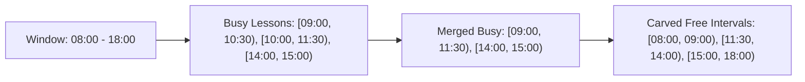

# Availability Algorithm Reference

The core value proposition of When R U Free rests on its local computation engine: **[`AvailabilityService`](file:///c:/Users/brosf/Documents/A%20vio%20projects/whenru3/When-R-U-Free/whenrufree/lib/services/availability_service.dart)**. This service is implemented as a pure, stateless Dart class with zero platform or framework dependencies, making it deterministic and unit-testable.

---

## 1. Mathematical Representation

Time is treated as integer minutes elapsed since midnight:
- Range: `[0, 1440)` where $0 = \text{00:00}$ and $1440 = \text{24:00}$.
- A lesson or event is represented as a half-open interval $[s, e)$ where $s < e$.
- A search window is bounded by $[W_{\text{start}}, W_{\text{end}})$, commonly defaulted to $[480, 1080)$ ($08:00\text{ to }18:00$).

---

## 2. Interval Carving (`freeIntervalsForDay` & `freeIntervalsForDate`)

To find when an individual is free on a given day:

1. **Clip to Window:** Every lesson $[L_s, L_e)$ on that weekday is clipped to the active window:
   $$[s', e') = [\max(L_s, W_{\text{start}}), \min(L_e, W_{\text{end}}))$$
   Intervals where $e' \le s'$ are discarded.
2. **Sort:** Busy intervals are sorted in ascending order by start time $s'$.
3. **Merge Overlapping Classes:** If two classes overlap or touch ($s'_{k} \le e'_{k-1}$), they are combined:
   $$[s'_{k-1}, \max(e'_{k-1}, e'_{k}))$$
4. **Carve Complements:** The algorithm scans from $W_{\text{start}}$ to $W_{\text{end}}$. Any span between consecutive busy intervals is recorded as a `FreeSlot`:
   $$\text{Free} = \{ [C, s') \mid s' > C \}$$
   where $C$ advances to $\max(C, e')$. If $C < W_{\text{end}}$, the trailing slot $[C, W_{\text{end}})$ is added.

---

## 3. Mutual Group Intersection (`mutualFreeOnDay` & `intersectAll`)

Given $N$ participants, where each participant $p_i$ has a set of free intervals $F_i$:

The mutual free slots for the entire group is the intersection:
$$M = \bigcap_{i=1}^{N} F_i$$

### Two-Pointer Intersection (`_intersectTwo`)
The intersection of two sorted free lists $A$ and $B$ uses a standard two-pointer sweep in $O(|A| + |B|)$ time:
- Compare $A[i] = [s_a, e_a)$ and $B[j] = [s_b, e_b)$.
- Overlap start $S = \max(s_a, s_b)$, overlap end $E = \min(e_a, e_b)$.
- If $E > S$, record $[S, E)$ with union of free participants.
- Advance index $i$ if $e_a < e_b$, otherwise advance $j$.
- Filter out slots with duration $E - S < \text{minDurationMin}$ (default: 15 minutes).

---

## 4. Adaptive Free Block Grouping (`groupedFreeBlocks`)

Used in the **Week** view to avoid showing fragmented micro-slots. It produces maximal intervals over which the exact set of free friends remains constant:

1. **Collect Boundaries:** Extract all interval endpoints from lessons and busy overrides for all participants that fall within $[W_{\text{start}}, W_{\text{end}})$.
2. **Sort Boundaries:** Remove duplicates and sort the boundary list:
   $$B = \{ b_0, b_1, b_2, \dots, b_m \}$$
3. **Sample Midpoints:** For each adjacent slice $[b_k, b_{k+1})$, test the midpoint $t_{\text{mid}} = \frac{b_k + b_{k+1}}{2}$.
4. **Determine Free Participants:** Identify all participants not in a lesson or busy override at $t_{\text{mid}}$.
5. **Merge Adjacent Slices:** If the current slice has the exact same subset of free people as the previous slice (and includes the current user plus at least one friend), merge them into a single continuous block.
6. **Filter Slivers:** Discard merged blocks shorter than $\text{minDurationMin}$.

---

## 5. Meetup Ranking (`bestSlotsAcrossWeek`)

Ranks available breaks across all 5 weekdays:
1. **Full-Group Pass:** Searches for slots where 100% of the group is free.
2. **Partial-Group Fallback:** If full-group breaks are unavailable or scarce, it samples 15-minute stepping buckets across the day, identifying subsets of $\ge 2$ people who are free together.
3. **Sorting Criteria:**
   - Headcount (number of free friends) descending.
   - Duration (length of break in minutes) descending.
   - Chronological weekday and start time.
