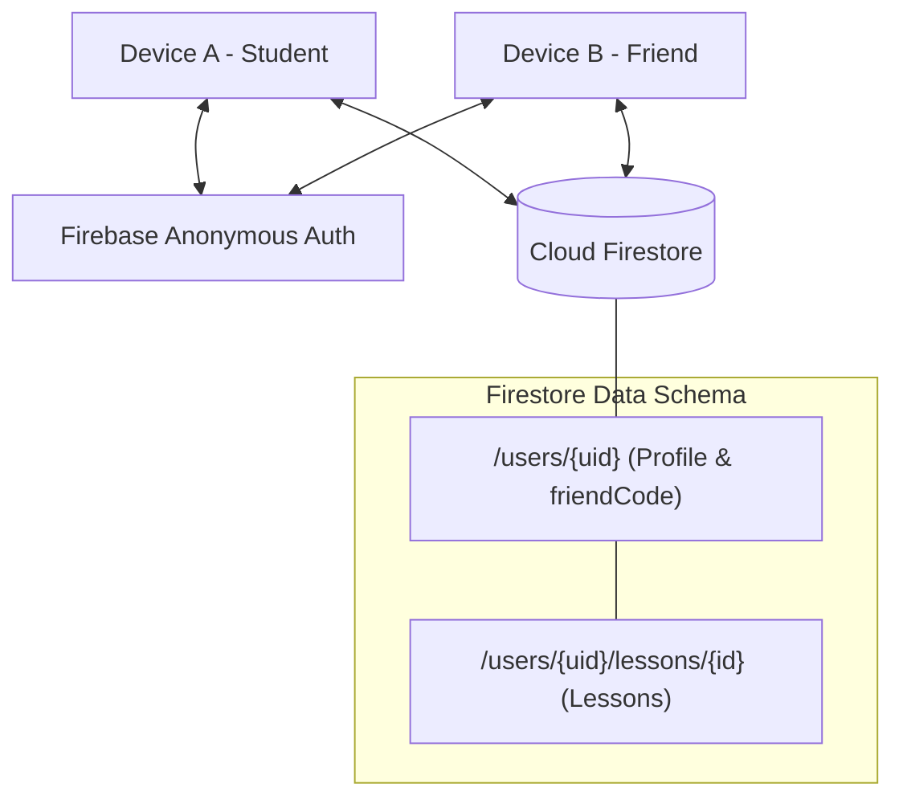

# Cloud Sync & Firebase Setup Guide

When R U Free is local-first by default, meaning all features operate completely offline without a cloud backend. However, the codebase contains a **fully-implemented cloud synchronization layer** (`FirestoreDataStore`) that enables automatic timetable syncing across friends and cross-device account restoration once configured.

---

## 1. Cloud Architecture



- **Anonymous Authentication:** Keeps onboarding frictionless. Users do not need an email or password to sync; an anonymous UID is generated automatically.
- **Friend Code Lookup:** Each user gets a 6-character alphanumeric friend code. Looking up a code retrieves that user's public profile and weekly lessons.
- **Dormant Safeguard:** When `kCloudBackendEnabled = false` (or Firebase keys are empty), the app gracefully skips cloud initialization and operates locally with zero overhead.

---

## 2. Firebase Project Setup (Free Spark Plan)

Follow these steps to activate cloud synchronization for your deployment:

### Step 1: Create a Firebase Project
1. Go to the **[Firebase Console](https://console.firebase.google.com)**.
2. Click **Add project** (e.g. `when-r-u-free`).
3. Disable Google Analytics and Gemini (not needed for the app).
4. Select the free **Spark plan** (requires no credit card or billing).

### Step 2: Enable Anonymous Authentication
1. In the Firebase console sidebar, navigate to **Build** → **Authentication**.
2. Click **Get started**.
3. Under the **Sign-in method** tab, select **Anonymous** → toggle to **Enable** → click **Save**.

### Step 3: Create Cloud Firestore Database
1. In the sidebar, navigate to **Build** → **Firestore Database**.
2. Click **Create database**.
3. Select a location close to your users (e.g. `europe-west3` or `us-central1`).
4. Choose **Start in production mode**.
5. Once created, click the **Rules** tab, replace the contents with the following security rules, and click **Publish**:

```javascript
rules_version = '2';
service cloud.firestore {
  match /databases/{db}/documents {
    match /users/{uid} {
      // Any authenticated user can read profiles (needed for friend lookup)
      allow read: if request.auth != null;
      // Only the user themselves can write their profile
      allow write: if request.auth != null && request.auth.uid == uid;

      match /lessons/{id} {
        // Friends can read lessons
        allow read: if request.auth != null;
        // Only the owner can write or delete their lessons
        allow write: if request.auth != null && request.auth.uid == uid;
      }
    }
  }
}
```

---

## 3. Configuring the App

You can generate the configuration automatically using the FlutterFire CLI or paste values manually:

### Option A: Using FlutterFire CLI (Recommended)
1. Install the CLI if not already installed:
   ```bash
   dart pub global activate flutterfire_cli
   ```
2. Run configuration inside the Flutter project directory:
   ```bash
   cd whenrufree
   flutterfire configure
   ```
3. Follow the interactive prompts to associate your Firebase project with Android, iOS, macOS, Windows, and Web.

### Option B: Manual Configuration
1. In Firebase Console, go to **Project settings** (`⚙️`) → **General** → **Your apps**.
2. Add your target platforms (Android, iOS, Web).
3. Copy the `apiKey`, `appId`, `messagingSenderId`, and `projectId`.
4. Open `lib/firebase_options.dart` and paste them into the respective `FirebaseOptions` structures.

---

## 4. Activating Cloud Sync in Code

Once keys are present:
1. Open `lib/config/cloud_config.dart`.
2. Flip `kCloudBackendEnabled` to `true`:
   ```dart
   const bool kCloudBackendEnabled = true;
   ```
3. Re-run or rebuild the app:
   ```bash
   flutter run
   ```

The app will now automatically connect to Firestore on startup, sign in anonymously, and push local timetable edits to the cloud.
